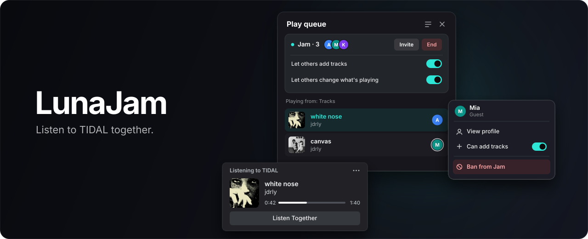

Shared Jam listening rooms and Discord `Listen Together` inside TIDAL Desktop via [TidaLuna](https://github.com/Inrixia/TidaLuna). Audio streams and TIDAL credentials remain on each listener's machine. Only room state, track IDs, queue actions, and clock-compensated playback positions cross the relay.

## Install

1. Open **TIDAL Settings -> Plugins -> Plugin Store**.
2. Add the store URL:

```text
https://github.com/Fuchs-Fox/lunajam/releases/download/latest/store.json
```

3. Click **Install** on **LunaJam**.

Direct store link on the machine running TIDAL:

```text
tidaluna://settings/store?installfromurl=https://github.com/Fuchs-Fox/lunajam/releases/download/latest/store.json
```

## Capabilities

- **Play queue integration**: A Jam button sits in the footer player bar beside Lyrics and Queue. Active sessions mount directly below TIDAL's Play Queue header with stacked participant avatars, an invite QR/code drawer, and per-track contributor badges on every queue row. Track and playlist context menus also expose `Start a Jam` and `Add to Jam`.
- **Participant controls and permissions**: The host controls room-wide `Let others add tracks` and `Let others change what's playing` switches. Clicking any listener avatar or track contributor badge opens a floating menu with `View profile` (navigates to `/@handle` or `/artist/:id` inside TIDAL when the listener has a public TIDAL profile), a per-listener `Can add tracks` switch, and `Ban from Jam` (removes every track that participant queued and blocks reentry until the host ends and recreates the room).
- **Audio modes and drift sync**: Guests switch between `This device` (local TIDAL playback synced by median-RTT clock offset and three-zone drift compensation) and `Host speaker` (local player pauses while playback controls forward directly to the host).
- **Discord Rich Presence and Listen Together**: Broadcasts `Listening to TIDAL` activity with track artwork, album tooltip, live progress bar, and a `Listen Together` button. Clicking a solo listener's `Listen Together` link promotes their active queue into a live Jam room automatically.

## Discord RPC on Linux and Flatpak

LunaJam connects directly to Discord over native IPC (`\\.\pipe\discord-ipc-*` on Windows, Unix domain sockets on Linux) before falling back to local `arRPC` WebSockets (`127.0.0.1:6463..6472`). On Linux, LunaJam probes `$XDG_RUNTIME_DIR/lunajam-ipc-0..9` first before standard `discord-ipc-*` and `.flatpak` locations.

- **Unboxed or native `tidal-hifi`**: Connects out of the box to native Discord, Flatpak Discord (`app/com.discordapp.Discord`), Vesktop (`.flatpak/dev.vencord.Vesktop/xdg-run` or `app/dev.vencord.Vesktop`), Equibop (`.flatpak/org.equicord.equibop/xdg-run` or `app/org.equicord.equibop`), and Snap Discord (`snap.discord`).
- **Flatpak `tidal-hifi` (`com.mastermindzh.tidal-hifi`) + Flatpak Equibop or Vesktop**: `com.mastermindzh.tidal-hifi` only mounts `xdg-run/app/com.discordapp.Discord` by default and pre-creates `discord-ipc-0..9` symlinks inside its own persistent `.flatpak` runtime directory. Do not expose `--filesystem=xdg-run/discord-ipc-0` to `tidal-hifi`, or Bubblewrap (`bwrap`) fails at startup when overwriting the cached `discord-ipc-0` symlink. Note also that `arRPC-Bun v1.3.4` inside current Equibop builds crashes on incoming WebSocket RPC upgrades on port `6463`, so Unix IPC via a dedicated `lunajam-ipc-0` symlink is required:

1. If `xdg-run/discord-ipc-0` was previously overridden, reset it first so `tidal-hifi` launches cleanly:

```sh
flatpak override --user --reset com.mastermindzh.tidal-hifi
rm -f "/run/user/$(id -u)/discord-ipc-0" ~/.config/user-tmpfiles.d/discord-rpc.conf
```

2. Symlink Equibop's (or Vesktop's) Flatpak IPC socket to `$XDG_RUNTIME_DIR/lunajam-ipc-0` and grant `tidal-hifi` access:

```sh
mkdir -p ~/.config/user-tmpfiles.d
echo 'L %t/lunajam-ipc-0 - - - - .flatpak/org.equicord.equibop/xdg-run/discord-ipc-0' > ~/.config/user-tmpfiles.d/lunajam-rpc.conf
systemctl --user enable --now systemd-tmpfiles-setup.service
flatpak override --user --filesystem=xdg-run/lunajam-ipc-0 com.mastermindzh.tidal-hifi
```

For `dev.vencord.Vesktop`, replace `org.equicord.equibop` with `dev.vencord.Vesktop`.

3. Restart `tidal-hifi`, verify **Settings -> Custom / Vesktop RPC -> Configure Rich Presence** has `arRPC` enabled in Equibop/Vesktop, and disable any separate standalone `DiscordRPC` plugin in TidaLuna so two plugins do not overwrite each other's presence.

## Settings

Configured inside **TIDAL Settings -> Plugins -> LunaJam**:

| Setting | Description | Default |
| --- | --- | --- |
| Discord Rich Presence | Enable or disable presence updates on Discord, Vesktop, and Equibop | `true` |
| Listen Together button in Discord | Attach a join button during Jams and solo listening | `true` |
| Show paused tracks in Discord | Keep activity visible while playback is paused | `true` |
| Allow guests to add tracks by default | Initial state of `Let others add tracks` | `true` |
| Allow guests to control playback by default | Initial state of `Let others change what's playing` | `true` |
| Default join audio mode | Start in `This device` or `Host speaker` when joining | `This device` (`remote`) |
| Relay server URL | HTTP/WebSocket origin for rooms and `/join/:token` links | `https://lunajam.sn0w13.de` |
| Discord Application ID | Built-in TIDAL application ID; leave as `1130698654987067493` unless using a custom Discord Developer Portal app | `1130698654987067493` |

## Self-Hosting the Relay

The relay server is a stateless-disk Node.js HTTP and WebSocket process in `server/`. Rooms, standby links, and bans stay in memory with automatic TTL cleanup.

Run via Docker Compose:

```sh
npm install && npm run build
docker compose up -d
curl -fsS http://127.0.0.1:8642/healthz
```

Or run the built bundle directly with Node 22+:

```sh
node server/build/server.mjs
```

HTTP endpoints exposed by the relay:

- `GET /healthz` — Plain-text health check returning `ok`.
- `GET /api/resolve/:token` — JSON room summary for invite pages and client preflight.
- `GET /join/:token` — Browser handoff page that probes LunaJam's loopback bridge (`127.0.0.1:24860..24869`) before falling back to `tidaluna://`.

Configuration environment variables (see `docker-compose.yml` and `server/src/config.ts`):

| Variable | Description | Default |
| --- | --- | --- |
| `LUNAJAM_PORT` | Listen port for HTTP and WebSocket upgrades | `8642` |
| `LUNAJAM_HOST` | Bind address | `0.0.0.0` |
| `LUNAJAM_PUBLIC_URL` | Canonical public URL used in share and Discord links | `https://lunajam.sn0w13.de` |
| `LUNAJAM_MAX_PARTICIPANTS` | Maximum listeners per room | `32` |
| `LUNAJAM_HOST_GRACE_MS` | Grace window before ending a room after host disconnects | `20000` |
| `LUNAJAM_ROOM_TTL_MS` | Idle room expiration window | `900000` |
| `LUNAJAM_RATE_LIMIT` | Maximum WebSocket messages per connection per second | `60` |
| `LUNAJAM_MAX_CONNECTIONS` | Maximum concurrent WebSocket clients | `512` |
| `LUNAJAM_IDLE_MS` | WebSocket inactivity termination timeout | `90000` |
| `LUNAJAM_MAX_ROOMS` | Maximum concurrent active rooms | `256` |
| `LUNAJAM_ROOMS_PER_CONN` | Maximum rooms created per connection (`docker-compose.yml`) | `2` |
| `LUNAJAM_TLS_CERT` | Optional PEM certificate path for direct TLS (`main.ts`) | unset |
| `LUNAJAM_TLS_KEY` | Optional PEM private key path for direct TLS (`main.ts`) | unset |

## Development

Requires Node.js `>= 22.0.0`. See [Architecture](./docs/ARCHITECTURE.md) for wire protocol, clock synchronization, and TIDAL Redux integration internals.

```sh
npm install
npm run lint
npm test
npm run build
npm run dev
```
