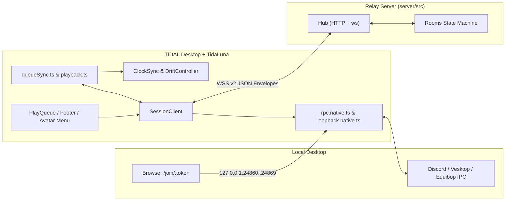

# LunaJam Architecture

LunaJam splits responsibilities cleanly between the TIDAL renderer sandbox, `@luna/lib` native Node helpers, and the WebSocket relay server. No audio data, DRM tokens, or TIDAL credentials leave the local machine.

## Protocol v2

Defined in [`plugins/lunajam/src/protocol.ts`](../plugins/lunajam/src/protocol.ts). Both client and relay validate every envelope against `v: 2` (`decodeClient` and `decodeServer`).

- **Room codes**: 8-character Crockford Base32 identifiers excluding `I`, `L`, `O`, and `U`. Input normalization accepts URLs, deep links (`tidaluna://lunajam/join/...`), bare codes, and case-folded lookalikes (`O->0`, `I/L->1`).
- **Standby promotion**: When **Listen Together button in Discord** is enabled while listening solo, `SessionClient` opens a lightweight `standby` session (`s_<base64url>`). If another listener resolves or joins that token, `Rooms` promotes the standby state atomically into a live room, issues a `hostToken`, and sends `standby.promoted` to the creator so playback and queue continuity stay intact without recreating a session manually.
- **Host grace reconnect**: If a host socket drops transiently, `Rooms` holds the room open for `LUNAJAM_HOST_GRACE_MS` (`20s` default) and lets the host reclaim leadership via `hostToken`.
- **Two-tier track permissions**: Rooms carry both a global `allowGuestAdd` boolean and per-participant `canAddTracks` overrides (`room.memberPermission`), checked locally in `TidalQueueSync` and enforced authoritatively in `Rooms`.
- **Room-scoped bans**: `room.kick` permanently bans the target from that room instance (`endReason: 'banned'`) by three keys: salted SHA-256 prefix of the client's persistent `peerId`, `tidalUserId` (`user.meta.id`), and non-shared client IP (loopback and multi-guest shared IPs are excluded to avoid collateral NAT bans). Banning also strips every track in `room.queue` where `addedBy.cid === targetCid`. Creating a new Jam resets the ban list.

## TIDAL Desktop Synchronization

TIDAL's React + Redux desktop client presents three quirks that shaped `plugins/lunajam/src/tidal/`:

1. **Redux `content.mediaItems` preloading (`metadata.ts`)**: TIDAL's `MQ` selector (`currentElementAsMediaProduct`) and PlayQueue row selector read `redux.store.getState().content.mediaItems[String(mediaItemId)]`. When a guest joins with tracks not yet loaded locally, `ensureQueueInStore` fetches missing IDs via `MediaItem.fromId` (coercing numeric IDs via `toNativeItemId`, loading the active `priorityTrackId` first and remaining items in batches of 4) before re-applying the room queue.
2. **Non-destructive queue reconciliation (`queueSync.ts`)**: Dispatching `playQueue/RESET` every time a track is added or removed interrupts audio playback. When `currentNative.mediaItemId` already matches `room.queue[room.currentIndex].trackId`, `syncSurroundings` splices elements before and after `currentIndex` using `playQueue/REMOVE_AT_INDEX`, `playQueue/ADD_AT_INDEX`, `playQueue/ADD_LAST`, and `playQueue/SET_CURRENT_INDEX` without touching the audio pipeline.
3. **Guaranteed track transitions and initial seek timing (`playback.ts`)**: In TIDAL 9.0.0, `playQueue/RESET` updates `playQueue.currentIndex` with `autoplay: false` and leaves `playbackContext.actualProductId` on the previous song. After `applyRoomToNative`, `applyRemoteTick` checks `playbackContext.actualProductId` against `playback.trackId` and dispatches `PlayState.moveTo(targetIdx)` (or `PlayState.play(id)` if absent from the local queue window) with a `3000ms` in-flight guard even when `pq.currentIndex === targetIdx`. Initial seeks wait for `PlayState.state === 'PLAYING'` (re-triggered on a microtask inside `PlayState.onState` after the Redux reducer commits) so buffering does not consume the `2500ms` seek cooldown.
4. **Host windowing index mapping**: Large queues are capped at `MAX_SEED_ITEMS = 50` on creation and `80` items on host reconciliation to stay comfortably under the `262144`-byte WebSocket payload cap (`hub.ts`). `roomIndexForNativeIndex` translates host native indices back into the active room slice before sending `playback.sync`.

## Clock Offset and Drift Hysteresis

- **`ClockSync` (`sync/clock.ts`)**: Pings the relay periodically and stores up to `8` `(rtt, offset)` samples computed from `(serverTs - (clientSent + rtt / 2))`. The effective offset is the median of the lowest-RTT half of samples, rejecting network jitter spikes.
- **`DriftController` (`sync/drift.ts`)**: Evaluates `expectedMs - actualMs` on `<audio>/<video>` elements against three zones:
  - `|delta| < 300ms`: No adjustment; restores `playbackRate = 1` once `|delta| < 120ms`.
  - `300ms <= |delta| <= 1200ms`: Nudges `HTMLMediaElement.playbackRate` to `1.025` or `0.975`.
  - `|delta| > 1200ms` (or `> 400ms` on forced initial/transition seeks): Executes `PlayState.seek(expectedMs / 1000)` with a `2500ms` cooldown between unforced seeks.

## UI Mounting and Contributor Avatars

- **`FooterButtonMount` (`ui/footerButton.tsx`)**: Mounts `.lj-footer-btn` into TIDAL's `[data-test="footer-player"] [class*="_utilityButtons_"]` bar with explicit `:focus-visible` `border-radius: 8px` overrides so keyboard Tab focus stays crisp.
- **`QueueHeaderMount` (`ui/queueHeader.tsx`)**: Locates `[data-test="playqueue"]` and inserts `.lj-queue-mount` directly after `:scope > [data-test="playqueue-header"]` using `--lj-surface: rgba(255, 255, 255, 0.06)` and `#1d1e24` avatar ring tokens tuned for dark TIDAL surfaces.
- **`QueueAvatarDecorator` (`ui/queueAvatars.ts`) & `participantMenu.tsx`**: Resolves `addedBy` ownership across `[data-test="playqueue-item"]` rows via `data-test-media-item-id`, row order, and React Fiber keys when available, injecting clickable avatar buttons that open the single-instance participant context menu.

## Discord RPC and Loopback Handoff

- **`rpc.native.ts`**: Implements binary Discord IPC framing (`OP_HANDSHAKE = 0`, `OP_FRAME = 1`, `OP_CLOSE = 2`, `OP_PING = 3`, `OP_PONG = 4`). On Windows it scans `\\.\pipe\discord-ipc-0..9`. On Linux it scans `$XDG_RUNTIME_DIR`, `$TMPDIR`, `/tmp`, and Flatpak/Snap subdirectories (`app/com.discordapp.Discord`, `app/dev.vencord.Vesktop`, `app/org.equicord.equibop`, `.flatpak/org.equicord.equibop/xdg-run`, `.flatpak/dev.vencord.Vesktop/xdg-run`, `.flatpak/com.discordapp.Discord/xdg-run`, `snap.discord`) before falling back to local `arRPC` WebSockets on `127.0.0.1:6463..6472` (`Origin: https://discord.com`). Ports whose WebSocket closes right after HTTP upgrade without sending a frame enter a `300s` cooldown to avoid crash-looping older `arRPC-Bun` builds.
- **`loopback.native.ts` & `server/src/joinPage.ts`**: Binds an unprivileged localhost HTTP endpoint on the first free port in `127.0.0.1:24860..24869` returning `Access-Control-Allow-Private-Network: true`. Opening a Discord `Listen Together` link (`https://<relay>/join/<token>`) triggers the page to probe those localhost ports from the browser, passing the room token straight to the running TIDAL client (`tidalWindow.focus()`) and falling back to `tidaluna://` if no local bridge responds.
